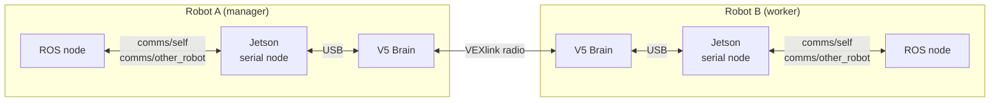
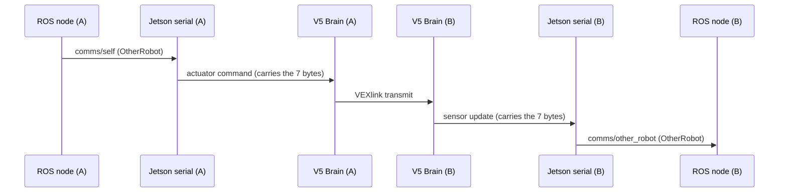

# Inter-Robot Communication (Robot A ↔ Robot B)

> **Status:** draft for review. Sections marked **(planned)** describe work that is not built yet.
> Items marked **(unverified)** have not been confirmed on hardware.

This document describes how two robots exchange bytes over VEXlink, using the Jetson ↔ V5 Brain serial bridge
described in [README.md](README.md). Read that first if you are new to the bridge.

## At a glance

- Each robot's **V5 Brain** has a **VEXlink radio**. The two radios talk to each other.
- The Brain is a **dumb byte pipe**: it carries a fixed-size block of bytes and never reads it. Only ROS nodes know what the bytes mean.
- **Robot A is the manager** (VEXlink transmitter, 1040 B/s). **Robot B is the worker** (receiver, 520 B/s). Data flows **both ways**.
- Today the block is the 7-byte `OtherRobot` packet. Sending your own data means choosing a layout that fits the bandwidth budget (section 3).

## 1. How the bytes travel



One round trip for a packet sent from A to B:



B to A is the same path in reverse.

### Who does what

| Stage | Component | Action |
|---|---|---|
| Produce | ROS node (e.g. `InterRobotCommsNode`) | Quantizes data into an `OtherRobot` message on `comms/self` |
| Cache | `JetsonV5SerialNode::interRobotSelfCallback` | Packs the message into bytes and stores them in the RHI |
| Carry to Brain | Actuator-command stream | The bytes ride at the end of every actuator command |
| Radio | `relay_inter_robot_link()` in [main.cpp](main.cpp) | Transmits the bytes (throttled), receives the peer's bytes |
| Carry to Jetson | Sensor-update stream | The received bytes ride at the end of every sensor update |
| Consume | `JetsonV5SerialNode::publishV5SensorUpdate` | Unpacks to `comms/other_robot`, and publishes `comms/link_connected` |

Note that the Jetson only forwards the peer's bytes when a sensor update arrives. If the serial link is down, the
peer data goes stale.

## 2. The payload

The size of the payload is the **only** thing the V5 knows. The layout lives only on the ROS side.

| Item | Where | Shared with the V5? |
|---|---|---|
| Field layout | [OtherRobot.msg](../../../03_ROS/ghost_msgs/msg/OtherRobot.msg) | No |
| Pack / unpack code | `packOtherRobot` / `unpackOtherRobot` in `ghost_ros_interfaces::msg_helpers` | No |
| Size (`OTHER_ROBOT_PACKET_SIZE` = 7) | [other_robot_packet.hpp](../../../01_Libraries/ghost_v5_interfaces/include/ghost_v5_interfaces/inter_robot/other_robot_packet.hpp) | **Yes** |

The current `OtherRobot` packet is 7 one-byte fields:

| Byte | Field | Meaning |
|---|---|---|
| 0 | `x` | map x, 5 cm per unit |
| 1 | `y` | map y, 5 cm per unit |
| 2 | `theta` | heading, 0..255 maps to [0, 2π) |
| 3 | `status` | `UNKNOWN`, `COLLECTING`, `SCORING`, `PARKING`, `STUCK`, or `VERSION` |
| 4 | `target_x` | intended target x (or the protocol version when `status == VERSION`) |
| 5 | `target_y` | intended target y |
| 6 | `seq` | heartbeat counter (liveness and loss detection) |

A `static_assert` ties the packer's byte count to `OTHER_ROBOT_PACKET_SIZE`, so changing the message without
changing the constant fails the build.

## 3. Bandwidth budget

VEXlink limits how many bytes each robot can send. Which end transmits is set in each robot's YAML.

| | Robot A (manager / transmitter) | Robot B (worker / receiver) |
|---|---|---|
| Bandwidth | 1040 B/s | 520 B/s |
| Per 10 ms main-loop cycle (100 Hz) | 10.4 B | 5.2 B |
| 7-byte packet at 100 Hz | 700 B/s fits | 700 B/s **too much** |
| Current setting (one packet per 250 ms) | 28 B/s | 28 B/s |

Rule of thumb: `bytes per second = packet bytes × sends per second`, and it must stay under the sender's limit.

The send rate is set by `inter_robot_link_tx_period_ms` in [main.h](../include/main.h) (250 ms today). It is one
value for both robots. VEXlink's own per-packet overhead is **(unverified)**, so leave headroom.

## 4. Configuration

Each robot's YAML has an `inter_robot_link` block. Example:
[pinky_hardware_config.yaml](../../../11_Robots/ghost_override/config/pinky/pinky_hardware_config.yaml).

```yaml
inter_robot_link:                    # omit, or set port 0, to disable the relay
    port: 16                         # V5 smart port the radio is plugged into
    link_id: "ghost_override_link"   # MUST be identical on both robots
    is_transmitter: true             # true on one robot (manager), false on the other (worker)
```

`generate_pros_header` reads this block when building the V5 program and writes it into `robot_config.hpp` as
`INTER_ROBOT_LINK_PORT`, `INTER_ROBOT_LINK_ID`, and `INTER_ROBOT_LINK_IS_TRANSMITTER`. `main.cpp` then creates the
`pros::Link` from them. The Jetson ignores this block. (See the generation section of [README.md](README.md).)

In the repo today, Pinky is the transmitter and Inky is the receiver. Which of these is Robot A and which is
Robot B for your project is **(to confirm)**.

## 5. Using it

### ROS interface

| Topic | Type | Direction | Notes |
|---|---|---|---|
| `comms/self` | `ghost_msgs/OtherRobot` | to the peer | Cached, then sent with the next actuator command |
| `comms/other_robot` | `ghost_msgs/OtherRobot` | from the peer | Peer's latest packet. All zeros means "no data yet" |
| `comms/link_connected` | `std_msgs/Bool` | from the Brain | This robot's VEXlink radio status |

`InterRobotCommsNode` is the stock node: it publishes this robot's pose and status on `comms/self`, and turns the
peer's packet into a `map → other_robot/base_link` TF.

### Simple example: send one packet by hand

```bash
# Robot A: send one packet
ros2 topic pub --once /comms/self ghost_msgs/msg/OtherRobot \
  "{x: 10, y: 20, theta: 64, status: 1, target_x: 0, target_y: 0, seq: 1}"

# Robot B: the same fields arrive here
ros2 topic echo /comms/other_robot
```

`InterRobotCommsNode` also publishes `comms/self` (10 Hz) when it is launched, so stop it for this test or its
packets will mix with yours. This test has not been run on hardware yet **(unverified)**.

### Quick checks

```bash
ros2 topic echo /comms/link_connected   # radio up on this robot?
ros2 topic echo /comms/other_robot      # peer data arriving?
```

### Troubleshooting

| Symptom | Likely cause |
|---|---|
| `link_connected` is false | `link_id` differs between robots, both robots have the same `is_transmitter`, or the radio is on a different port than the YAML says |
| `comms/other_robot` all zeros | Peer is not transmitting yet, or the link is down |
| Data arrives but is stale | The Jetson ↔ Brain serial link dropped (see [README.md](README.md), failure handling) |
| Build fails after editing `OtherRobot.msg` | `OTHER_ROBOT_PACKET_SIZE` was not updated to match |

## 6. Tests that exist

| Test | What it checks |
|---|---|
| `test_other_robot_codec.cpp` | Packing and unpacking of the `OtherRobot` fields |
| `test_inter_robot_publisher.cpp` / `test_inter_robot_receiver.cpp` | The producer and consumer halves of the node |
| `test_inter_robot_loopback.cpp` | Whole ROS round trip with a loopback in place of the Brain and radio |

All under [03_ROS/ghost_ros_interfaces/test](../../../03_ROS/ghost_ros_interfaces/test).

## 7. Planned work **(planned)**

To fill in as the Robot A / Robot B design is decided:

- [ ] Payload for A → B and for B → A (fields, sizes, rates), checked against the budget in section 3.
- [ ] Separate send rates for manager and worker (today there is one shared period).
- [ ] Measure real throughput and VEXlink overhead using the `seq` counter.
- [ ] Guide: add your own data to the link (step by step).
