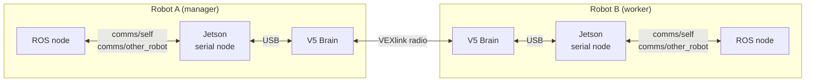
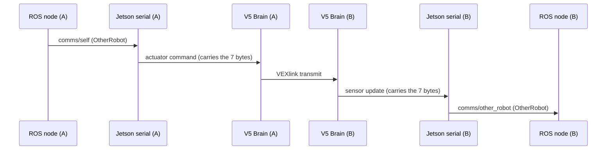

# Inter-Robot Communication (Robot A ↔ Robot B)

This document describes how two robots exchange bytes over VEXlink, using the Jetson ↔ V5 Brain serial bridge
described in [JETSON_V5_BRIDGE.md](JETSON_V5_BRIDGE.md). Read that first if you are new to the bridge.

## At a glance

- Each robot's **V5 Brain** has a **VEXlink radio**. The two radios talk to each other.
- The Brain is a **dumb byte pipe**: it carries a fixed-size block of bytes and never reads it. Only ROS nodes know what the bytes mean.
- **Robot A is the manager** (VEXlink transmitter, 1040 B/s). **Robot B is the worker** (receiver, 520 B/s). Data flows **both ways**.
- Today the block is the 7-byte `OtherRobot` packet. To put your own data on the link, see section 6.

## 1. How the bytes travel



One round trip for a packet sent from A to B:



B to A is the same path in reverse.

### Who does what

| Stage | Component | Action |
|---|---|---|
| Produce | ROS node (e.g. `InterRobotCommsNode`) | Quantizes data into an `OtherRobot` message on `comms/self` |
| Cache | `JetsonV5SerialNode::interRobotSelfCallback` | Packs the message into bytes and stores them in the RHI |
| Carry to Brain | Actuator-command stream | The bytes ride at the end of every actuator command |
| Radio | `relay_inter_robot_link()` in [main.cpp](main.cpp) | Transmits the bytes (throttled), receives the peer's bytes |
| Carry to Jetson | Sensor-update stream | The received bytes ride at the end of every sensor update |
| Consume | `JetsonV5SerialNode::publishV5SensorUpdate` | Unpacks to `comms/other_robot`, and publishes `comms/link_connected` |

Note that the Jetson only forwards the peer's bytes when a sensor update arrives. If the serial link is down, the
peer data goes stale.

## 2. The payload

The size of the payload is the **only** thing the V5 knows. The layout lives only on the ROS side.

| Item | Where | Shared with the V5? |
|---|---|---|
| Field layout | [OtherRobot.msg](../../../03_ROS/ghost_msgs/msg/OtherRobot.msg) | No |
| Pack / unpack code | `packOtherRobot` / `unpackOtherRobot` in `ghost_ros_interfaces::msg_helpers` | No |
| Size (`OTHER_ROBOT_PACKET_SIZE` = 7) | [other_robot_packet.hpp](../../../01_Libraries/ghost_v5_interfaces/include/ghost_v5_interfaces/inter_robot/other_robot_packet.hpp) | **Yes** |

The current `OtherRobot` packet is 7 one-byte fields:

| Byte | Field | Meaning |
|---|---|---|
| 0 | `x` | map x, 5 cm per unit |
| 1 | `y` | map y, 5 cm per unit |
| 2 | `theta` | heading, 0..255 maps to [0, 2π) |
| 3 | `status` | `UNKNOWN`, `COLLECTING`, `SCORING`, `PARKING`, `STUCK`, or `VERSION` |
| 4 | `target_x` | intended target x — **(planned)**, see below (carries the protocol version when `status == VERSION`) |
| 5 | `target_y` | intended target y — **(planned)**, see below |
| 6 | `seq` | heartbeat counter (liveness and loss detection) |

Two things the field list does not show:

- **`x` and `y` are unsigned and clamped.** `InterRobotCommsNode` clamps each to 0..255, so the representable
  range is 0 .. 12.75 m and **any negative coordinate silently clamps to 0**. This assumes a map frame whose
  origin sits at a field corner. `theta` wraps instead of clamping, so it has no such limit.
- **`target_x` / `target_y` are not populated yet.** Outside version packets the stock node leaves them at 0.

To change these fields or add your own, see section 6.

## 3. Bandwidth budget

VEXlink limits how many bytes each robot can send, and the manager end gets double the worker's bandwidth.
Which end is which is set in each robot's YAML.

> From the official VEX *VEXlink* documentation: "A manager robot has double the available bandwidth to send
> information to the worker robot. Maximum data rate for manager to worker robot is 1040 bytes/second. Maximum
> data rate for worker to manager robot is 520 bytes/second."

VEX's "manager" and "worker" are PROS's `E_LINK_TRANSMITTER` and `E_LINK_RECIEVER`, which is what
`is_transmitter` in the YAML selects. The names are misleading: **both ends send and receive** — the
designation only sets which end gets the larger share of the bandwidth.

| | Robot A (manager / transmitter) | Robot B (worker / receiver) |
|---|---|---|
| Bandwidth | 1040 B/s | 520 B/s |
| Per 10 ms main-loop cycle (100 Hz) | 10.4 B | 5.2 B |
| 7-byte packet at 100 Hz | 700 B/s fits | 700 B/s **too much** |
| Current setting (one packet per 250 ms) | 28 B/s | 28 B/s |

Rule of thumb: `bytes per second = packet bytes × sends per second`, and it must stay under the sender's limit.

## 4. Configuration

Each robot's YAML has an `inter_robot_link` block. The per-robot configs live under
[11_Robots/ghost_override/config](../../../11_Robots/ghost_override/config), one directory per robot, as
`<robot>/<robot>_hardware_config.yaml`. Robot names change from season to season, so check that directory and
[robots.yaml](../../../robots.yaml) rather than trusting a name written in this document.

```yaml
inter_robot_link:                    # omit, or set port 0, to disable the relay
    port: 16                         # V5 smart port the radio is plugged into
    link_id: "ghost_override_link"   # MUST be identical on both robots, and unique to your team
    is_transmitter: true             # true on the manager, false on the worker
```

VEX's documentation warns that `link_id` is hashed by vexos into the radio's ID, and recommends it carry
something team-specific (a team number, say) because a generic string risks colliding with another team's link
at an event. The value above is generic; worth revisiting before a competition.

`generate_pros_header` reads this block when building the V5 program and writes it into `robot_config.hpp` as
`INTER_ROBOT_LINK_PORT`, `INTER_ROBOT_LINK_ID`, and `INTER_ROBOT_LINK_IS_TRANSMITTER`. `main.cpp` then creates the
`pros::Link` from them. The Jetson ignores this block. (See [JETSON_V5_BRIDGE.md](JETSON_V5_BRIDGE.md),
section 3.1.)

To find out which robot is the manager today, grep the configs — exactly one should say `true`:

```bash
grep -rn "is_transmitter" 11_Robots/ghost_override/config/
```

Which robot plays Robot A (manager) and which plays Robot B (worker) for your project is **(to confirm)**.

## 5. Using it

### ROS interface

| Topic | Type | Direction | Notes |
|---|---|---|---|
| `comms/self` | `ghost_msgs/OtherRobot` | to the peer | Cached, then sent with the next actuator command |
| `comms/other_robot` | `ghost_msgs/OtherRobot` | from the peer | Peer's latest packet. All zeros means "no data yet" |
| `comms/link_connected` | `std_msgs/Bool` | from the Brain | This robot's VEXlink radio status |
| `comms/self_status` | `std_msgs/UInt8` | into `InterRobotCommsNode` | Sets the `status` byte this robot reports. Defaults to `STATUS_UNKNOWN`. This is the intended way for the behaviour layer to drive status without the comms node depending on the strategy stack |

`InterRobotCommsNode` ([inter_robot_comms_node.hpp](../../../03_ROS/ghost_ros_interfaces/include/ghost_ros_interfaces/comms/inter_robot_comms_node.hpp))
is the stock node, started by `hardware.launch.py`. It publishes this robot's quantized pose and status on
`comms/self`, and turns the peer's packet into a `map → other_robot/base_link` TF. Four behaviours to know
before you rely on it:

- **It publishes at `publish_rate_hz`, but not unconditionally.** Each cycle it looks up `map → base_link`; if
  that transform is missing it logs a throttled warning and **skips the cycle entirely**, sending nothing.
  `seq` advances only on an actual publish, so a gap in `seq` at the receiver means real packet loss rather
  than a skipped cycle — which is what makes `seq` usable for measuring throughput.
- **Every `version_rate_hz` seconds a version packet replaces that cycle's pose packet.** It carries
  `status = STATUS_VERSION` and the `protocol_version` parameter in `target_x`.
- **A version mismatch silently mutes the peer.** If a received `STATUS_VERSION` packet's `target_x` does not
  equal this node's `protocol_version`, the node marks the peer incompatible and **drops every later peer
  packet without broadcasting a TF**, until a matching version packet arrives. The only outward sign is a
  throttled warning in the log, so this is worth checking first when peer data stops appearing in TF.
- **An all-zero packet is ignored**, so a slot the peer has never written never broadcasts a bogus pose at the
  map origin.

| Parameter | Default | Meaning |
|---|---|---|
| `map_frame` / `base_frame` | `map` / `base_link` | Frames looked up to build this robot's packet |
| `peer_base_frame` | `other_robot/base_link` | Child frame of the TF broadcast for the peer |
| `position_resolution_m` | `0.05` | Metres per `x` / `y` unit |
| `protocol_version` | `1` | Must match on both robots, or the peer is muted |
| `publish_rate_hz` | `10.0` | `comms/self` rate |
| `version_rate_hz` | `0.5` | Version-announcement rate (0 disables announcements) |

### Simple example: send one packet by hand (TEST EXAMPLE FOR CORRECTNESS - NOT TESTED)

```bash
# Robot A: send one packet
ros2 topic pub --once /comms/self ghost_msgs/msg/OtherRobot \
  "{x: 10, y: 20, theta: 64, status: 1, target_x: 0, target_y: 0, seq: 1}"

# Robot B: the same fields arrive here
ros2 topic echo /comms/other_robot
```

`InterRobotCommsNode` also publishes `comms/self` (10 Hz) when it is launched, so stop it for this test or its
packets will mix with yours.

### Quick checks

```bash
ros2 topic echo /comms/link_connected   # radio up on this robot?
ros2 topic echo /comms/other_robot      # peer data arriving?
```

### Troubleshooting

| Symptom | Likely cause |
|---|---|
| `link_connected` is false | `link_id` differs between robots, both robots have the same `is_transmitter`, or the radio is on a different port than the YAML says |
| `comms/other_robot` all zeros | Peer is not transmitting yet, or the link is down |
| Data arrives but is stale | The Jetson ↔ Brain serial link dropped (see [JETSON_V5_BRIDGE.md](JETSON_V5_BRIDGE.md), section 1.5) |
| `comms/other_robot` has data, but the peer TF never appears | `protocol_version` differs between the robots, so the receiver has muted the peer (see the `InterRobotCommsNode` notes above) |
| Peer pose is pinned at the map origin | The peer's coordinates went negative and clamped to 0 (section 2) |
| A field added to `OtherRobot.msg` never arrives | `OTHER_ROBOT_PACKET_SIZE` and the pack/unpack functions were not updated. **Nothing fails the build** — see section 6 |
| Build fails with "OtherRobot wire layout changed" | You changed `OTHER_ROBOT_PACKET_SIZE`; update `packOtherRobot`, `unpackOtherRobot` and the `static_assert` literal to match |

## 6. Adding your own data to the link

**The V5 brain never changes.** It relays a fixed-size block of opaque bytes and never inspects it, so adding
data is a ROS-side job plus one shared constant that tells the brain how big the block is.

### Where the type changes

| Hop | What the data is | Done by |
|---|---|---|
| Your producer node | `ghost_msgs::msg::OtherRobot` | your code |
| → `comms/self` | ROS message | — |
| → RHI outbound slot | `OtherRobotBytes` (`std::array<uint8_t, N>`) | **`packOtherRobot`** |
| → actuator command stream | raw bytes appended to the frame | `RobotHardwareInterface::serialize` |
| → V5 brain → VEXlink → peer brain | **opaque bytes, never inspected** | `relay_inter_robot_link()` |
| → sensor update stream → RHI inbound slot | raw bytes | `RobotHardwareInterface::deserialize` |
| → `comms/other_robot` | ROS message | **`unpackOtherRobot`** |
| Your consumer node | `ghost_msgs::msg::OtherRobot` | your code |

`packOtherRobot` / `unpackOtherRobot` are the only type boundary. Everything between them moves bytes.

### Adding a field

`OtherRobot.msg` **is** the wire format: every field is a single already-quantized byte, with no CDR padding.
Keep new fields `uint8` and quantize before publishing, the way `x` / `y` / `theta` are.

| File | Change |
|---|---|
| [OtherRobot.msg](../../../03_ROS/ghost_msgs/msg/OtherRobot.msg) | Add the field |
| `msg_helpers.cpp` → `packOtherRobot` **and** `unpackOtherRobot` | Write and read it, same position in both |
| [other_robot_packet.hpp](../../../01_Libraries/ghost_v5_interfaces/include/ghost_v5_interfaces/inter_robot/other_robot_packet.hpp) → `OTHER_ROBOT_PACKET_SIZE` | New total byte count |
| `msg_helpers.cpp` → the `static_assert` literal | The same new count — it is hard-coded |
| [test_other_robot_codec.cpp](../../../03_ROS/ghost_ros_interfaces/test/test_other_robot_codec.cpp) | `wireSizeIsSeven` asserts the count and *will* fail (rename it too). `byteOrderIsStable`'s expected-byte list silently zero-fills, so extend it or the new field goes untested |

Then re-check the budget in section 3, and **rebuild both the ROS workspace and the V5 program** — the size is
baked into the serial message length on each side, and a mismatch means no valid messages at all.

### What the compiler catches, and what it doesn't

`static_assert(OTHER_ROBOT_PACKET_SIZE == 7, ...)` compares the constant against a hard-coded literal. It fires
only when you change **the constant**, forcing you back to the pack/unpack functions.

It does not work the other way round. Add a field to `OtherRobot.msg`, leave the constant alone, and the build
is clean while the field is **silently never transmitted** — `packOtherRobot` goes on writing the same 7 bytes.
(The `assert(i == ...)` below it is a runtime assert, compiled out under `NDEBUG`.) Nothing warns you, so treat
the table above as a single atomic change.

### What you never touch

`RobotHardwareInterface`, `ghost_serial` and every line of V5 code size themselves from
`OTHER_ROBOT_PACKET_SIZE`: `OtherRobotBytes` is `std::array<uint8_t, OTHER_ROBOT_PACKET_SIZE>`, the RHI adds
that constant to both stream lengths, and `relay_inter_robot_link()` transmits `tx.size()` bytes. Change the
constant and all of it follows. **A payload change needs no V5-side edit.**

### If you need a second, independent packet

There is one slot, carrying one packet type. To add a genuinely separate message, either multiplex on the
`status` byte (as `STATUS_VERSION` already does — it reuses `target_x` to mean something else) or interleave by
sending different layouts on alternate cycles. A second physical slot would mean changing the RHI and the V5
relay, and is **(planned)** at best; prefer multiplexing.

## 7. Tests that exist

| Test | What it checks |
|---|---|
| `test_other_robot_codec.cpp` | Packing and unpacking of the `OtherRobot` fields |
| `test_inter_robot_publisher.cpp` / `test_inter_robot_receiver.cpp` | The producer and consumer halves of the node |
| `test_inter_robot_loopback.cpp` | Whole ROS round trip with a loopback in place of the Brain and radio |

All under [03_ROS/ghost_ros_interfaces/test](../../../03_ROS/ghost_ros_interfaces/test).

## 8. Planned work **(planned)**

To fill in as the Robot A / Robot B design is decided:

- [ ] Payload for A → B and for B → A (fields, sizes, rates), checked against the budget in section 3.
- [ ] Separate send rates for manager and worker (today there is one shared period).
- [ ] Measure real throughput and VEXlink overhead using the `seq` counter.
