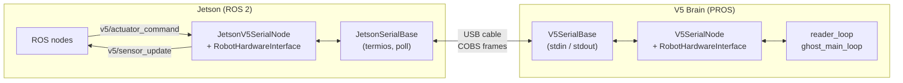
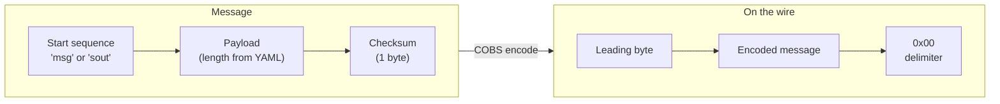
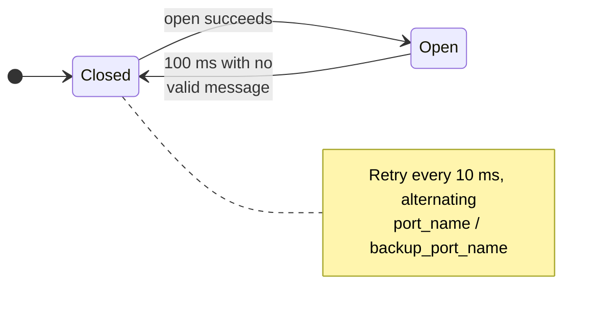
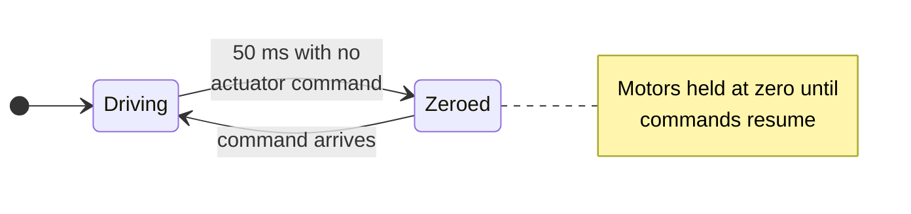
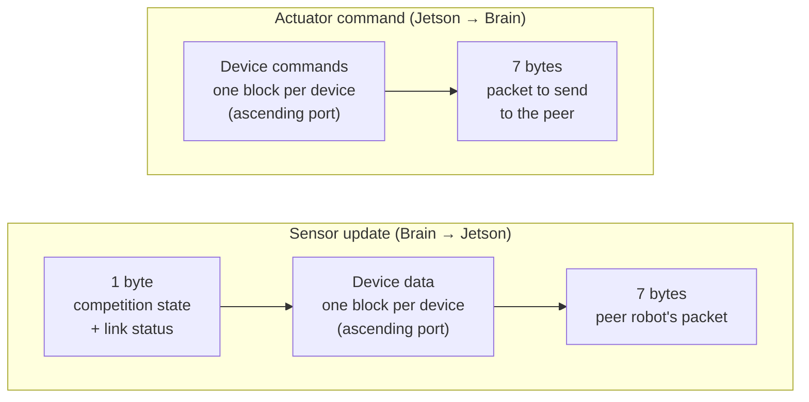

# NVIDIA Jetson ↔ V5 Brain Communication

This document describes the serial bridge between the NVIDIA Jetson (ROS 2) and the V5 Brain (PROS),
how the robot YAML configuration drives it, and how to use it. Robot-to-robot messaging over VEXlink, which
rides on this bridge, is documented separately in [INTER_ROBOT_COMMS.md](INTER_ROBOT_COMMS.md).

## At a glance

- One **USB cable** joins the Jetson and the V5 Brain. Everything travels over it as small framed messages.
- **Jetson → Brain:** commands for motors and outputs.
- **Brain → Jetson:** sensor and joystick data.
- A small fixed slot in each message also carries bytes for the other robot ([INTER_ROBOT_COMMS.md](INTER_ROBOT_COMMS.md)).
- Both sides build their message layout from the **same robot YAML**, so they always agree on sizes.
- Normally never touch the serial code. Read and write values through the `RobotHardwareInterface` (RHI) or ROS topics.

## Simple example

### Drive a motor from robot code

In a robot plugin, set a motor through the RHI. The bridge carries it to the Brain and back.
This is the pattern from [ghost_example_robot.cpp](../../../10_Examples/ghost_example_robot/src/ghost_example_robot.cpp):

```cpp
void MyRobot::teleop(double current_time)
{
  // Command: Jetson -> Brain
  rhi_ptr_->setMotorVoltageCommandPercent("left_motor", 0.5);      // -1.0 .. 1.0
  rhi_ptr_->setMotorCurrentLimitMilliAmps("left_motor", 2500.0);   // defaults to 0: motor is weak without this

  // Feedback: Brain -> Jetson
  double position = rhi_ptr_->getMotorPosition("left_motor");
}
```

`left_motor` must exist under `devices:` in the robot YAML (see section 2).

To send data to the other robot, see the example in [INTER_ROBOT_COMMS.md](INTER_ROBOT_COMMS.md).

## 1. Structure of the connection



### 1.1 Physical components

| Component | Role | What to check if it fails |
|---|---|---|
| Jetson | Runs ROS 2 and the Jetson serial node | Is the node running? Is the port visible? |
| USB cable | Jetson USB port → V5 Brain USB port | `ls /dev/serial/by-id/` should list a `*V5_Brain*` entry |
| V5 Brain | Runs the PROS program; exposes a CDC-ACM serial device | Program must be running; the user-program channel is PROS `stdin`/`stdout` |

The Jetson finds the Brain by its stable name `/dev/serial/by-id/*V5_Brain*-if02`, falling back to
`/dev/ttyACM1` ([hardware.launch.py:208](../../../11_Robots/ghost_override/launch/hardware.launch.py)).
That `-if02` is the user-program interface is **(unverified)**. Only the Override robot's launch file uses
the by-id lookup; other configs default to `/dev/ttyACM1`.

### 1.2 Software components

| Component | Location | Responsibility |
|---|---|---|
| `ghost_serial` library | [01_Libraries/ghost_serial](../../../01_Libraries/ghost_serial) | Framing: start sequence, checksum, COBS. Compiled for both devices from the same source (symlinks into the PROS project). |
| `GenericSerialBase` | `ghost_serial/base_interfaces/` | Shared write path and framing config |
| `JetsonSerialBase` | same | Linux implementation: termios, `poll`, `ioctl` |
| `V5SerialBase` | same | PROS implementation: `stdin`/`stdout`, `fdctl` |
| `RobotHardwareInterface` (RHI) | [01_Libraries/ghost_v5_interfaces](../../../01_Libraries/ghost_v5_interfaces) | Device list built from the YAML; serializes and deserializes each stream |
| `JetsonV5SerialNode` | [03_ROS/ghost_ros_interfaces/src/serial/jetson_v5_serial_node.cpp](../../../03_ROS/ghost_ros_interfaces/src/serial/jetson_v5_serial_node.cpp) | ROS node: reads/writes serial, converts RHI ⇄ ROS messages |
| `V5SerialNode` | [ghost_v5/serial/v5_serial_node.cpp](ghost_v5/serial/v5_serial_node.cpp) | PROS side: applies actuator commands, sends state |
| `main.cpp` | [main.cpp](main.cpp) | PROS tasks `reader_loop`, `actuator_timeout_loop` and `screen_update_loop`, plus `ghost_main_loop()`, which is called from the competition-mode functions rather than from a task (section 5) |

### 1.3 Wire protocol

Both directions use the same frame, built by `GenericSerialBase::writeMsgToSerial` and parsed by `MsgParser`:



- **Start sequence:** `msg` (Jetson → V5), `sout` (V5 → Jetson).
- **Payload:** fixed length, computed from the YAML on each side (section 2).
- **Checksum:** one byte, the 8-bit sum of the payload (`use_checksum`, default true).
- **COBS:** adds a leading byte and a `0x00` delimiter.
- **Port settings:** Jetson opens raw 8N1 at 115200 baud, no flow control. The V5 disables PROS's own COBS
  (`SERCTL_DISABLE_COBS`) and sets blocking writes (`SERCTL_BLKWRITE`) in `initSerial()`.

Because lengths come from each side's own config, **the Jetson and the Brain must be built from the same
robot YAML**. A mismatch produces no valid messages; the Jetson logs
"Are both devices using the same robot config?".

### 1.4 Data flow

| Direction | Stream | Produced by | Consumed by | Contents |
|---|---|---|---|---|
| Jetson → V5 | actuator command | `actuatorCommandCallback` on `v5/actuator_command` | `reader_loop` → `readV5ActuatorUpdate()` | Motor commands/modes, current limits, digital outputs, inter-robot slot (outbound) |
| V5 → Jetson | sensor update | `ghost_main_loop` → `writeV5StateUpdate()` | `serialLoop` → publishes `v5/sensor_update` | Competition state, joysticks, motors, rotation sensors, IMU, digital inputs, inter-robot slot (inbound) and link status |

### 1.5 Failure handling

Two independent watchdogs, one on each end. Neither knows about the other.

| End | Watchdog | Fires after | Action |
|---|---|---|---|
| Jetson | `serialTimeoutLoop` | 100 ms with no valid message | Closes the port and rebuilds the serial interface; `serialLoop` reopens it |
| V5 Brain | `actuator_timeout_loop` | 50 ms with no actuator command (`cmd_timeout_ms`) | Zeroes every motor |

**Jetson — reconnects automatically.** The port alternation below only does anything when the two configured
names differ, which on the Override robots they do not (section 4.2).



**V5 Brain — fails safe on its own.**



The V5 side is the safety net: if the Jetson, the cable or the ROS stack drops out, the Brain stops the robot
without being told to.

### 1.6 Inter-robot slot

The last 7 bytes of each stream are reserved for robot-to-robot data. The bridge treats them as opaque bytes;
the VEXlink radio, the payload layout, and the bandwidth budget are covered in
[INTER_ROBOT_COMMS.md](INTER_ROBOT_COMMS.md).

## 2. YAML consumption

One YAML file per robot describes the hardware. Both devices read it, in different ways:

| Device | When | How |
|---|---|---|
| Jetson | Runtime | `robot_config_yaml_path` ROS parameter → `loadRobotConfigFromYAMLFile()` → `RobotHardwareInterface(config, COPROCESSOR)` |
| V5 Brain | Compile time | `generate_pros_header` converts the YAML to C++ (section 3); `main.cpp` calls `getRobotConfig()` → `RobotHardwareInterface(config, V5_BRAIN)` |

### 2.1 Selecting the robot for the V5 build

[robots.yaml](../../../robots.yaml) lists the available robots and picks one for the PROS build:

```yaml
selected_robot: MY_ROBOT
MY_ROBOT:
  config_file: 11_Robots/ghost_override/config/my_robot/my_robot_hardware_config.yaml
```

Robot names change from season to season as designs change, so `robots.yaml` is the source of truth for which
names exist. This document uses placeholders rather than naming the robots of any one year.

### 2.2 Structure of a robot YAML

One file per robot, under [11_Robots/ghost_override/config](../../../11_Robots/ghost_override/config) as
`<robot>/<robot>_hardware_config.yaml`.

```yaml
port_configuration:
    use_partner_joystick: false      # optional
    digital_io: { A: OUT, ... }      # ADI ports A-H as IN or OUT
    devices:
        drive_l1:
            port: 10
            type: MOTOR              # MOTOR | ROTATION_SENSOR | INERTIAL_SENSOR
            reversed: false
            config: drive_motor_config   # named block holding the device's settings
```

`loadRobotConfigFromYAML()` ([device_config_factory_utils.cpp](../../../01_Libraries/ghost_v5_interfaces/src/util/device_config_factory_utils.cpp)):
1. Loads the `digital_io` block.
2. Adds the main joystick (port -1), and the partner joystick (port -2) if enabled.
3. For each entry under `devices`, reads `type`, dispatches to the matching `load*DeviceConfigFromYAML`
   (which reads the named `config` block), then sets `name`, `port`, and `type`. An invalid or
   unsupported type throws.

The file may also contain an `inter_robot_link` block. It is not a device and is read separately; see
[INTER_ROBOT_COMMS.md](INTER_ROBOT_COMMS.md).

### 2.3 How the YAML sets the message size

The `RobotHardwareInterface` constructor creates one data object per device and adds up the packet sizes:

Each stream is the devices in order, then the inter-robot slot. The sensor update also starts with one status byte.



Each device's size depends on its `serial_config` flags. For example a rotation sensor sends 4 bytes per
enabled field (`send_angle_data`, `send_position_data`, `send_velocity_data`). Turning a flag on or off
in the YAML changes the message length on both devices, so both must be rebuilt together.

Devices are serialized in **ascending port order** (`std::map<int, DevicePair>`), so the joysticks
(negative ports) come first. The inter-robot slot always comes last.

## 3. Class and data type generation

There are two kinds of generated code, and they are easy to confuse.

### 3.1 V5: `robot_config.hpp` (generated C++)

`generate_pros_header` ([generate_pros_header.cpp](../../../01_Libraries/ghost_v5_interfaces/src/util/generate_pros_header.cpp))
turns the selected robot's YAML into `02_V5/ghost_pros/include/robot_config.hpp`. That path is deliberately not
a link: the file is git-ignored and regenerated on every build, so it exists only in your working tree after a
build. **Do not edit it.**

Steps:
1. Read `selected_robot` and `config_file` from `robots.yaml` (needs `VEXU_HOME`).
2. Load the YAML into a `DeviceConfigMap`.
3. `generateCodeFromRobotConfig()` emits `extern "C" DeviceConfigMap* getRobotConfig()`. It creates one
   `*DeviceConfig` per device and sets every field, including the filter, model, controller, and serial
   settings for motors.
4. Append the inter-robot link constants (see [INTER_ROBOT_COMMS.md](INTER_ROBOT_COMMS.md)).

`main.h` includes the header, and `main.cpp` calls `getRobotConfig()` to build the RHI. The V5 firmware has
no YAML parser; the YAML is baked in at build time.

### 3.2 ROS: message types (`ghost_msgs`)

ROS message types are generated by the normal ROS interface pipeline from `.msg` files in
[03_ROS/ghost_msgs/msg](../../../03_ROS/ghost_msgs/msg) (for example `V5SensorUpdate`, `V5ActuatorCommand`,
`OtherRobot`). The conversions between the RHI and these messages are written by hand in
`ghost_ros_interfaces::msg_helpers`: `toROSMsg`, `fromROSMsg`, `packOtherRobot`, `unpackOtherRobot`.

### 3.3 What is shared and what is not

| Item | Jetson | V5 |
|---|---|---|
| Robot YAML | read at runtime | read at build time, baked into `robot_config.hpp` |
| `RobotHardwareInterface`, device classes | same source | same source (symlinked) |
| ROS messages and `msg_helpers` | yes | no |
| Inter-robot payload size and layout | see [INTER_ROBOT_COMMS.md](INTER_ROBOT_COMMS.md) | |

## 4. Using the connection

### 4.1 Build and flash the V5

One command builds the workspace and flashes the Brain. `VEXU_HOME` must be set and the environment
sourced ([setup_env.sh](../../../scripts/setup_env.sh)); the build scripts abort without it.

```bash
# 1. Set selected_robot in robots.yaml to one of the robots listed in that file
# 2. Connect the V5 Brain over USB and power it on (the upload step needs it)
./scripts/ghost build
```

Use the same robot YAML for the Jetson launch (`robot_config_yaml_path`).

### 4.2 Launch on the Jetson

Each robot has its own launch file under
[11_Robots/ghost_override/launch](../../../11_Robots/ghost_override/launch) as `<robot>/<robot>.launch.py`,
included by `hardware.launch.py`. Each starts `ghost_serial_node` with:

| Parameter | Node default | Meaning |
|---|---|---|
| `port_name` / `backup_port_name` | `/dev/ttyACM1` / `/dev/ttyACM2` | Serial device to open; `initSerial()` alternates between the two after a failed open |
| `robot_config_yaml_path` | `""` | Robot YAML (must match the V5 build) |
| `use_checksum` | `true` | Must match the V5 (the V5 hardcodes `true`) |
| `read_msg_start_seq` / `write_msg_start_seq` | `sout` / `msg` | Must match the V5 |
| `verbose` | `false` | Print raw bytes read |

Those are the **node's own** defaults, and the port alternation described in section 1.5 is a no-op on the
Override robots, because both names end up pointing at the same device: the per-robot launch file passes the
by-id path resolved by `hardware.launch.py` as *both* `port_name` and `backup_port_name`, and
`base_ros_config.yaml` sets both to `/dev/ttyACM1` as the fallback. Don't go hunting for a failover that never
happens.

### 4.3 ROS interface

| Topic | Type | Direction | Notes |
|---|---|---|---|
| `v5/actuator_command` | `ghost_msgs/V5ActuatorCommand` | to V5 | Dropped with an error if the port is closed |
| `v5/sensor_update` | `ghost_msgs/V5SensorUpdate` | from V5 | Published for each valid message |

All use `SensorDataQoS`. The `comms/*` topics for robot-to-robot data are listed in
[INTER_ROBOT_COMMS.md](INTER_ROBOT_COMMS.md).

### 4.4 Quick checks

```bash
ls /dev/serial/by-id/                 # Brain visible?
ros2 topic hz /v5/sensor_update       # messages arriving?
```

### 4.5 Troubleshooting

| Symptom | Likely cause |
|---|---|
| "Failed to open serial device" repeating | Brain not running a program, wrong port, cable |
| "Received N bytes but found no compatible message" | Jetson and V5 built from different YAML, or mismatched start sequence/checksum setting |
| Motors stop | V5 `cmd_timeout_ms` (50 ms, in `main.h`) expired: no actuator commands arriving |

## 5. V5 class reference

`V5SerialNode` (namespace `ghost_v5`):
- `V5SerialNode(rhi_ptr)`: computes message lengths from the RHI and builds the `V5SerialBase`.
- `initSerial()`: disables PROS COBS, enables blocking writes.
- `readV5ActuatorUpdate()`: reads one frame; on success refreshes the connection time and calls `updateActuatorCommands`.
- `updateActuatorCommands(buffer)`: deserializes into the RHI, applies motor modes and commands, sets current limits (smallest first), and drives digital outputs.
- `writeV5StateUpdate()`: samples competition state, joysticks, motors, encoders, IMUs, and digital inputs into the RHI, then serializes and writes.

How [main.cpp](main.cpp) drives all this:

| Function | How it runs | What it does |
|---|---|---|
| `reader_loop` | PROS task, started in `initialize()` | Calls `readV5ActuatorUpdate()`, then delays `loop_frequency / 2`. `loop_frequency` is a **period in milliseconds** (10), so that is a 5 ms delay: the reader deliberately runs at *twice* the main-loop rate, because it blocks waiting on serial and must stay ahead of the producer |
| `actuator_timeout_loop` | PROS task, started in `initialize()` | Zeroes every actuator if no command has arrived for `cmd_timeout_ms` (50 ms) |
| `screen_update_loop` | PROS task, started in `initialize()` | Drives the Brain's LCD |
| `ghost_main_loop` | **Not a task.** Called from the body of `disabled()`, `competition_initialize()`, `autonomous()` and `opcontrol()`, each delaying `loop_frequency` (10 ms) | `relay_inter_robot_link()`, then `writeV5StateUpdate()`, then zeroes the motors if disabled, then `update_actuators()` |

Because `ghost_main_loop` runs from the competition-mode functions rather than from its own task, the sensor
update and the VEXlink relay run **only while one of those modes is active**, and they stop entirely if
`v5_globals::run` is cleared by an exception (`exit_main_loop`).
