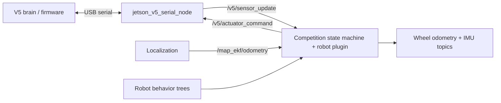
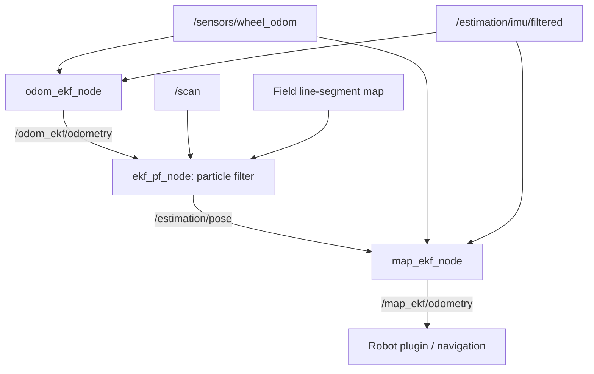
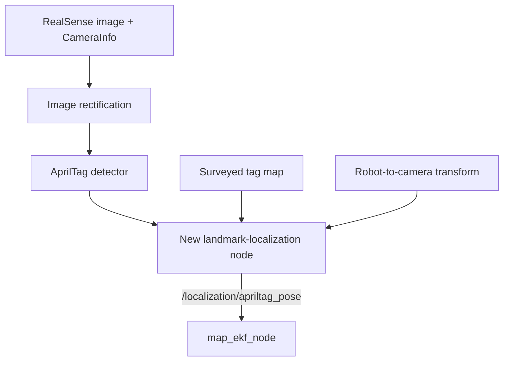

# ROS stack overview and AprilTag localization roadmap

This guide explains how `03_ROS` fits into the robot software, how localization currently works, what RealSense support exists, and where AprilTag landmark localization could be added.

**Review date: October 11, 2026.** This describes the source and configuration in the reviewed checkout. It is not a hardware validation report. The AprilTag design below is a proposal, not an implemented feature; no existing AprilTag detector or landmark-localization implementation was found during the review. Configuration and findings should be rechecked as the code changes.

## Repository organization

| Folder | Responsibility |
| --- | --- |
| [`01_Libraries`](../01_Libraries) | Reusable estimation, planning, control, hardware abstractions, and serial communication. |
| [`02_V5`](../02_V5) | Firmware for the V5 brain and auxiliary sensor host. |
| `03_ROS` | ROS messages, hardware bridges, sensing, localization, and supporting nodes. |
| [`04_Sim`](../04_Sim) | Simulation, including a simulated implementation of the V5 ROS interface. |
| [`11_Robots`](../11_Robots) | Robot-specific plugins, behavior trees, configuration, perception, and hardware launch files. |

The operational setup for the packages in `03_ROS` mostly lives in `11_Robots`. Reading only this directory misses the launch files and parameter values that connect the robot together.

## Packages in `03_ROS`

| Package | Role |
| --- | --- |
| [`ghost_msgs`](ghost_msgs) | Defines V5 sensor/actuator messages, trajectories, sensor-host messages, and services. |
| [`ghost_ros_interfaces`](ghost_ros_interfaces) | Bridges serial hardware into ROS, loads robot plugins, manages competition state, and provides recording, timers, and inter-robot communication. |
| [`ghost_sensing`](ghost_sensing) | Processes IMU measurements and classifies ball colors from sensor-host color readings. |
| [`ghost_localization`](ghost_localization) | Wraps the LiDAR particle filter, publishes pose estimates, and provides map-server launch support. |
| [`ghost_motion_planner_core`](ghost_motion_planner_core) | Provides a reusable planner interface for commands, odometry, and trajectories. |
| [`ghost_autonomy`](ghost_autonomy) | Currently contains a small test publisher. The substantive robot behavior lives in robot-specific code and behavior trees. |
| [`ghost_io`](ghost_io) | Interfaces with a PCF8575 GPIO expander. |
| [`ghost_io_py`](ghost_io_py) | Provides speech/audio support. |
| [`ghost_viz`](ghost_viz) | Provides PlotJuggler configuration and launch support. |

## Build and startup

The workspace targets **ROS 2 Humble**, uses `colcon`, and primarily builds C++ packages with `ament_cmake`, with Python components alongside them.

- [`scripts/setup_env.sh`](../scripts/setup_env.sh) sources Humble and the built workspace.
- [`scripts/build.sh`](../scripts/build.sh) builds the workspace, with different exclusions for desktop and embedded architectures. It also stops running services/processes and can proceed to PROS build/upload depending on options and environment; it is not just a compiler command.
- [`scripts/hardware/launch_hardware.sh`](../scripts/hardware/launch_hardware.sh) reads `/etc/ghost/robot_name` and launches `ghost_override hardware.launch.py` for that robot.
- [`hardware.launch.py`](../11_Robots/ghost_override/launch/hardware.launch.py) assembles shared hardware, transforms, map/navigation nodes, and robot-specific startup.
- [`pinky.launch.py`](../11_Robots/ghost_override/launch/pinky/pinky.launch.py) and [`inky.launch.py`](../11_Robots/ghost_override/launch/inky/inky.launch.py) load the serial bridge, competition plugin, IMU filter, and localization nodes.

Configuration is split across shared ROS settings, localization settings, per-robot ROS parameters, hardware-device configuration, and per-match initialization settings in [`ghost_override/config`](../11_Robots/ghost_override/config).

For environment setup, start with the [repository README](../README.md), [host setup guide](../SetupMyEnvironment.md), and [Docker guide](../12_Docker/README.md). Several hardware paths assume `~/VEXU_GHOST` or `/home/ghost/VEXU_GHOST`; desktop/container portability is incomplete.

## Hardware and control interfaces



The [V5 serial node](ghost_ros_interfaces/src/serial/jetson_v5_serial_node.cpp) translates between the V5 wire protocol and ROS messages. The [competition-state-machine node](ghost_ros_interfaces/src/competition/competition_state_machine_node.cpp) loads a robot implementation through `pluginlib`; the robot-specific launch chooses the plugin.

On each sensor update, [`V5RobotBase`](ghost_ros_interfaces/src/competition/v5_robot_base.cpp):

1. Updates disabled/autonomous/teleop state.
2. Copies sensor values into the shared hardware abstraction.
3. Calls the robot's sensor-update logic.
4. Executes the applicable competition callback.
5. Publishes actuator commands.

The [tank robot plugin](../11_Robots/ghost_tank/src/tank_robot_plugin.cpp) computes wheel odometry from motor positions and publishes IMU messages. Camera processing can run on the Jetson and feed localization without adding camera data to the V5 serial protocol.

A separate [RP2040/Pico serial bridge](ghost_ros_interfaces/src/serial/jetson_sensor_host_serial_node.cpp) publishes auxiliary color and distance sensor readings. Its device configuration comes from per-robot YAML files.

Simulation publishes and consumes the same V5 ROS message topics, allowing higher-level code to reuse that interface. This does not imply that camera or AprilTag simulation already exists.

## Current localization pipeline

The active hardware configuration is [`ghost_override/config/localization_config.yaml`](../11_Robots/ghost_override/config/localization_config.yaml), loaded by the robot-specific launches. It is more relevant to hardware behavior than the example configurations elsewhere in the repository.



### Local odometry EKF

`odom_ekf_node` is an instance of the external `robot_localization` EKF. It combines differential wheel-position measurements with IMU yaw and yaw rate. Its output, `/odom_ekf/odometry`, provides continuous local motion estimation.

### LiDAR particle filter

[`ekf_pf_node`](ghost_localization/src/ekf_pf_node.cpp) predicts motion from local EKF odometry and compares LiDAR scans against a field line-segment map. The underlying [particle-filter algorithm](../01_Libraries/ghost_estimation/src/particle_filter/particle_filter.cpp) lives in `01_Libraries/ghost_estimation`; the ROS wrapper supplies subscriptions, parameters, pose publication, and visualization.

It publishes `geometry_msgs/msg/PoseWithCovarianceStamped` on `/estimation/pose`, representing planar robot position and heading in `map`. It also accepts initialization through `/set_pf_pose`.

The active executable is **`ekf_pf_node`**. The similarly named `pf_ekf_node` has source and launch files, but its build target is commented out in the [package CMake file](ghost_localization/CMakeLists.txt).

### Global EKF

`map_ekf_node` is a second `robot_localization` EKF. It combines differential wheel-position measurements, IMU yaw rate, and the particle filter's absolute map-relative `x`, `y`, and yaw. It publishes `/map_ekf/odometry`, which the robot plugin uses as its primary pose topic.

The intended transform tree is:

```text
map -> odom -> base_link
                  |-- lidar_link
                  |-- imu_link
                  `-- camera_link -> camera sensor/optical frames
```

- `base_link` is the robot body frame, placed at the turning center projected onto the floor.
- `odom` supports smooth local motion but can drift.
- `map` provides field-relative positioning and can receive global corrections.
- The local EKF owns `odom -> base_link`; the global EKF owns `map -> odom`.
- `robot_state_publisher` publishes fixed sensor mounts from the robot URDF.
- The particle filter's own TF publication is disabled in the active configuration.

The particle filter uses a [line-segment field map](ghost_localization/maps/VEXFieldZeroLH.txt). Nav2 uses a separate [occupancy-grid map configuration](ghost_localization/maps/overrideMapConfig.yaml). A future tag map must share the same field coordinate convention; it is a third representation of known field geometry, not a replacement for either existing map.

## Existing RealSense support

RealSense integration exists, but camera startup is disabled in the main hardware launch.

| Support | Location and status |
| --- | --- |
| Camera driver launch | [`hardware.launch.py`](../11_Robots/ghost_override/launch/hardware.launch.py) constructs an inclusion of `realsense2_camera/rs_launch.py`. |
| Startup enablement | `realsense_node` is commented out in the returned `LaunchDescription`. |
| Stream configuration | Color `424x240 @ 15 FPS`, depth `480x270 @ 15 FPS`, depth aligned to color, camera gyro/accelerometer disabled. These are configured requests, not verified supported profiles for every model. |
| Mount transform | [`ghost_override.urdf.xacro`](../11_Robots/ghost_override/urdf/ghost_override.urdf.xacro) defines `base_link -> camera_link`. |
| Image consumer | [`cv_detector_array.py`](../11_Robots/push_back_cv/scripts/cv_detector_array.py) expects RealSense color, aligned depth, and color calibration topics. |
| Existing perception | [`push_back_cv`](../11_Robots/push_back_cv) performs YOLO detection, block tracking, and goal-state estimation. Its inclusion in hardware startup is also commented out. |
| Camera IMU test | [`imu_test.launch.py`](ghost_sensing/launch/imu_test.launch.py) launches RealSense gyro/accelerometer streams, the IMU filter, and RViz. It requires an IMU-equipped camera and matching configuration. |
| ROS dependencies | [`ghost_sensing/package.xml`](ghost_sensing/package.xml) and [`push_back_cv/package.xml`](../11_Robots/push_back_cv/package.xml) declare `realsense2_camera` as a runtime dependency. |
| Jetson setup commands | [`service.sh`](../scripts/hardware/service.sh) contains udev/kernel-module installation under its `autologin` branch. The corresponding block in [`configure-os.sh`](../scripts/hardware/configure-os.sh) is commented out. |
| Docker dependencies | The [`Dockerfile`](../12_Docker/Dockerfile) explicitly skips `librealsense2` and `realsense2_camera` during rosdep installation. The development compose configuration does not configure camera USB passthrough. |

The existing CV consumer expects:

```text
/camera/camera/color/image_raw
/camera/camera/color/camera_info
/camera/camera/aligned_depth_to_color/image_raw
```

The configured camera mounting translation is approximately `(0.193675, -0.047930, 0.342417)` meters in `base_link`, with roll/pitch/yaw `(0, 0.349066, 0.261799)` radians: 20 degrees downward pitch and 15 degrees yaw.

These files provide a starting point, but do not establish that a fresh machine has a working camera installation. Verify the actual camera model, JetPack/kernel version, installed RealSense SDK and ROS wrapper versions, USB access, and supported stream profiles. The historical kernel-module installer should not be treated as a model-independent setup procedure.

## Findings to address before integration

These findings were identified by source inspection, not runtime reproduction.

### Hardware launch selects a missing Nav2 configuration

[`hardware.launch.py`](../11_Robots/ghost_override/launch/hardware.launch.py) selects `ghost_override/config/nav2_config.yaml`, but the file in the reviewed checkout is [`ghost_tank/config/nav2_config.yaml`](../11_Robots/ghost_tank/config/nav2_config.yaml). The map server and navigation nodes will not receive the intended configuration through the selected path.

### Disabled camera startup still requires the camera package during launch construction

`get_package_share_directory("realsense2_camera")` executes while constructing `hardware.launch.py`, even though the resulting action is omitted from the returned launch list. A machine without that package can therefore fail to construct the hardware launch. This is particularly relevant to the Docker dependency exclusions.

### Particle-filter covariance is incorrectly normalized

In [`ParticleFilter::GetLocation`](../01_Libraries/ghost_estimation/src/particle_filter/particle_filter.cpp), weighted squared deviations are divided by particle count rather than total weight. After resampling, weights sum to one, so this introduces an extra division by particle count: 250 in the active configuration. It can make the global EKF substantially over-trust the particle-filter pose relative to AprilTag measurements.

Correct and verify the covariance calculation before tuning the relative trust assigned to these pose sources. The PF and global EKF also share wheel/IMU information through the pipeline, so their inputs are correlated; tuning should account for that limitation rather than treating every estimate as independent evidence.

### Timestamp and simulated-time handling need attention

The [IMU filter](ghost_sensing/src/imu_filter_node.cpp) and [particle-filter pose publisher](ghost_localization/src/ekf_pf_node.cpp) stamp output with processing time. The particle-filter node also explicitly sets `use_sim_time=false`.

Camera observations should preserve acquisition timestamps, and transforms should be evaluated at those timestamps. Simulation and bag replay require a consistent clock. Existing timestamp behavior should be reviewed when comparing delayed camera estimates with the rest of localization.

## Proposed AprilTag integration

Add an independent tag-derived pose input to the existing **global EKF**:



### Detection

A ROS 2 detector such as [`christianrauch/apriltag_ros`](https://github.com/christianrauch/apriltag_ros/blob/master/README.md) consumes rectified images and matching `CameraInfo`, publishes detection metadata, and publishes camera-relative tag transforms. It needs the tag family and physical tag size. Depth is not required for this pose-estimation path.

Pin a Humble-compatible detector version and verify its interfaces. Do not assume that the detection-array message itself contains a ready-to-fuse robot pose. In the documented implementation, tag poses are published through TF.

The existing color topic is `image_raw`: provide rectification and consistent calibration before feeding a detector that expects `image_rect`. The current low-resolution stream may need adjustment after measuring tag detection range and motion blur. Match subscription QoS to the actual camera publishers.

### Converting a tag observation into robot position

The new landmark node must answer: given where a tag is in the field and where the camera sees it, where is the robot?

Let `T_A_B` denote the pose of frame B expressed in frame A, mapping coordinates from B into A:

```text
T_map_base = T_map_tag * inverse(T_camera_tag) * inverse(T_base_camera)
```

This requires:

- A surveyed landmark file containing tag IDs, physical sizes, and full positions/orientations in the existing `map` frame.
- A calibrated robot-to-camera transform.
- Camera-relative detections and transforms evaluated at the image timestamp.
- Quality checks and uncertainty estimates.
- A `geometry_msgs/msg/PoseWithCovarianceStamped` output representing **`base_link` in `map`**.

Use the same camera frame throughout the transform calculation, including its optical-frame conversion. Compute the full 3D transform before extracting planar `x`, `y`, and yaw: the current mount is pitched and yawed.

Verify the mount's physical reference point. RealSense optical coordinates differ from robot coordinates, and the documented `camera_link` origin is at the left infrared sensor. The driver supplies internal sensor transforms; a measurement to the camera housing center may need adjustment. See the [RealSense frame documentation](https://github.com/realsenseai/realsense-ros/blob/ros2-master/README.md#ros2robot-vs-opticalcamera-coordination-systems).

### Global EKF input

The global EKF already uses `pose0` for the particle-filter pose. A proposed additional input is:

```yaml
# Add under map_ekf_node.ros__parameters in localization_config.yaml.
# Proposed configuration; requires the new publisher described above.
pose1: /localization/apriltag_pose
pose1_config: [
  true,  true,  false, # x, y, z
  false, false, true,  # roll, pitch, yaw
  false, false, false, # linear velocity
  false, false, false, # angular velocity
  false, false, false  # linear acceleration
]
pose1_differential: false
pose1_relative: false
```

This preserves absolute field position. Keep tags out of the local odometry EKF, and leave the global EKF responsible for `map -> odom`. The landmark node should publish a measurement rather than a competing robot transform. See the [Humble filter documentation](https://github.com/cra-ros-pkg/robot_localization/blob/humble-devel/doc/state_estimation_nodes.rst).

### Measurement quality

- Reject unknown IDs, stale observations, implausible poses, and poor geometric estimates.
- Account for planar-tag pose ambiguity and inconsistent observations.
- Make covariance reflect range, viewing angle, corner accuracy, and calibration uncertainty. Detection confidence is not itself pose covariance.
- Combine or jointly evaluate tags from one image rather than treating them as independent full-pose updates.
- Publish no new pose measurement when no valid tag is visible; do not repeatedly stamp an old observation as fresh.
- Use separate TF frame names for surveyed landmarks and observed tags if both are published, avoiding multiple parents for the same tag frame.
- Verify the field origin, axes, units, and alliance-mirroring behavior against existing robot initialization logic.

### Suggested code locations

| Addition | Suggested location |
| --- | --- |
| Detector launch and camera/detector configuration | `03_ROS/ghost_sensing` |
| Landmark-to-robot pose conversion node | `03_ROS/ghost_localization` |
| Surveyed tag layout | A versioned field-specific YAML file, loaded by the landmark node |
| Camera mount calibration | Robot-specific URDF/configuration under `11_Robots` |
| Hardware enablement and global EKF input | `11_Robots/ghost_override` launch/configuration |

The existing `push_back_cv` pipeline can share the camera streams, but is not required for AprilTag localization. The proposed integration does not require changing V5 firmware or the serial message protocol.

## Implementation and validation sequence

1. Fix launch/dependency issues and verify RealSense images, calibration, and TF on the actual Jetson.
2. Run AprilTag detection independently and measure detection range, latency, and motion blur.
3. Implement landmark-to-robot pose conversion with deterministic tests for transform direction, camera offsets, tag orientation, and field coordinates.
4. Compare tag-only poses against measured robot positions before enabling fusion.
5. Correct particle-filter covariance, then add the global EKF input and test LiDAR/tag disagreements.
6. Record images, calibration, detections, TF, and odometry for repeatable tests covering motion, occlusion, dropout, and reacquisition. Verify clock behavior during replay.

The first milestone is a **camera-only bring-up and tag-only field-pose demonstration**, using the actual RealSense model and measured landmark layout. Validate fused localization before allowing it to drive autonomous motion.

## Suggested reading order

1. [`hardware.launch.py`](../11_Robots/ghost_override/launch/hardware.launch.py): overall hardware composition.
2. [`pinky.launch.py`](../11_Robots/ghost_override/launch/pinky/pinky.launch.py): robot plugin and localization startup; Inky follows the same structure.
3. [`localization_config.yaml`](../11_Robots/ghost_override/config/localization_config.yaml): actual filter inputs and state selection.
4. [`ekf_pf_node.cpp`](ghost_localization/src/ekf_pf_node.cpp): localization subscriptions, callbacks, and pose output.
5. [`particle_filter.cpp`](../01_Libraries/ghost_estimation/src/particle_filter/particle_filter.cpp): underlying prediction, laser observation, resampling, and covariance.
6. [`v5_robot_base.cpp`](ghost_ros_interfaces/src/competition/v5_robot_base.cpp) and [`tank_robot_plugin.cpp`](../11_Robots/ghost_tank/src/tank_robot_plugin.cpp): how sensor data becomes odometry and robot commands.
7. [`ghost_override.urdf.xacro`](../11_Robots/ghost_override/urdf/ghost_override.urdf.xacro): sensor mounting transforms.
